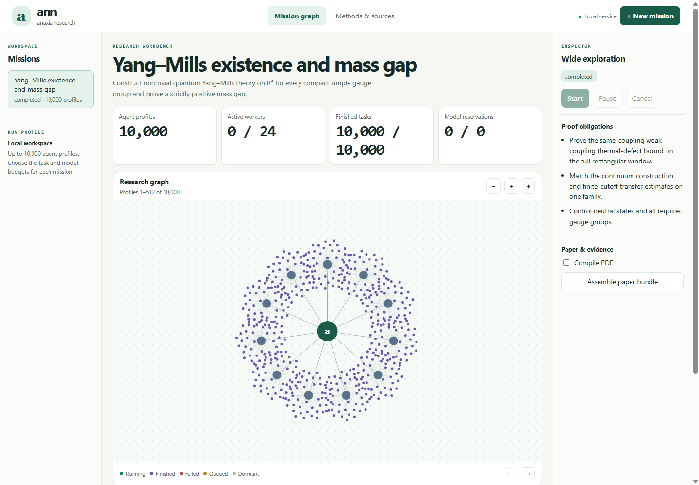

# ann research workbench

`ann` is an anaxia submodule for running mathematical research missions. Its local web app shows live activity, worker outcomes, and the links between the question, research routes, and agents. Select a node to inspect it. Use the controls beneath the graph to page through large missions.

```sh
python anaxia.py ann serve
python anaxia.py ann strategies
```

The default address is [127.0.0.1:8765](http://127.0.0.1:8765/). The browser and command line share the local SQLite database at `data/local/ann.sqlite3`. Pass `--db` before the command to use another database. A paused mission stops claiming work and lets active requests finish. Cancelling discards pending work and late worker results. A resumed run records expired requests as failures so paid calls cannot be silently replayed.



## Run a mission

```sh
python anaxia.py ann run --target modular-demo --export data/local/ann-exports
python anaxia.py ann run --target yang-mills --exploration wide --agents 10000 --tasks 10000 --concurrency 24 --export data/local/ann-exports --pdf
python anaxia.py ann run --target hodge --exploration wide --tasks 33 --export data/local/ann-exports --pdf
```

The default mode uses local exact calculations and produces a record of research obligations. A mission can schedule one task per profile, up to 10,000, with a local pool of up to 64 active workers. Routes are assigned in rotation, so large runs can repeat a method. Wide exploration adds an assumption stress test, quantifier and limit audit, and alternative construction. The two executable demonstrations check exact polynomial nonnegativity and a modular obstruction to an integer solution. PDF compilation is optional and requires `pdflatex`.

| Target | Routes | Main unresolved obligation |
| --- | --- | --- |
| Yang–Mills existence and mass gap | Thermal defect, renormalization group, separate spectral sectors, and continuum reconstruction | Prove the full same-coupling thermal-defect estimate and connect it to a matching nontrivial continuum theory. The built-in spectral calculation rechecks a finite-sampling obstruction for abstract spectra. [Official statement](https://www.claymath.org/wp-content/uploads/2022/06/yangmills.pdf) |
| Rational Hodge conjecture | Cycle classes, periods and monodromy, spreading, and admissible normal functions | Construct algebraic cycle representatives in general and prove equality in rational cohomology. The cycle route rechecks an explicit elliptic-curve family. [Exact elliptic power calculation](ANN-HODGE-ELLIPTIC.md) · [Official statement](https://www.claymath.org/millennium/hodge-conjecture/) · [Normal-function approach](https://arxiv.org/abs/0903.4903) · [Period calculations](https://arxiv.org/abs/2306.12931) |
| Riemann hypothesis | Explicit-formula positivity and reciprocal approximation | Establish a criterion with full infinite-range convergence or positivity bounds. [Official statement](https://www.claymath.org/millennium/riemann-hypothesis/) |
| Four-dimensional sphere packing | Contact geometry, radial shell and grid estimates | Extend the bounds to arbitrary packings in four dimensions. [Grid evidence](D4-GRID-PACKINGS.md) |

## Connect a model

Choose model-assisted mode in the app or use `ann run --spec mission.json` with a file like this one.

```json
{
  "template_id": "hodge",
  "author": "Deep Bhattacharjee",
  "exploration": "wide",
  "agent_count": 64,
  "max_tasks": 22,
  "concurrency": 4,
  "mode": "model",
  "max_model_calls": 8,
  "modelconfig": {"provider": "ollama", "model": "YOUR_INSTALLED_MODEL"}
}
```

The existing provider adapters support Ollama, a loopback OpenAI-compatible server such as llama.cpp, and opt-in official Claude, OpenAI, or Kimi endpoints. Set credentials outside the mission file. Official cloud calls send the mission statement and bounded public evidence notes to the selected provider. Model workers can receive a short selection of completed worker notes for review. A reservation is charged to the mission budget before the worker runs. Exact checks may finish before a reserved call is needed. [Provider setup](MODELS.md)

For an original problem, use `"template_id": "custom"` and set `statement`. Include a `task` in [the exact task format](EXACT-CERTIFICATES.md) to request executable verification. The paper identifies the formal task even if a broader research question was entered. Unchecked model text carries no proof authority. The Lean route records formalization obligations. The verification code checks supported certificates against the original task again during export.

## Imported repositories and methods

The workbench's Methods & Sources tab links the reviewed organization imports. The integrated verifier is anaxia's exact lab. The OpenGluon legacy entry point also accepts `ann`. The optional eBLLM adapter reads route data from the existing pinned `engines/anaxia` checkout. Initialize it with `git submodule update --init engines/anaxia` if you want the extra route catalogue.

| Design area | Source reviewed |
| --- | --- |
| Source tracking, worker roles, and local inference | [hyperresearch](https://github.com/anaxia-research/hyperresearch) · [openworker](https://github.com/anaxia-research/openworker) · [agency-agents](https://github.com/anaxia-research/agency-agents) · [claude-code-templates](https://github.com/anaxia-research/claude-code-templates) · [kimi-k3-in-c](https://github.com/anaxia-research/kimi-k3-in-c) · [colibri](https://github.com/anaxia-research/colibri) |
| Graph, notes, and Obsidian export | [animate](https://github.com/anaxia-research/animate) · [floorplan](https://github.com/anaxia-research/floorplan) · [gbrain](https://github.com/anaxia-research/gbrain) · [ai-memory](https://github.com/anaxia-research/ai-memory) · [open-second-brain](https://github.com/anaxia-research/open-second-brain) · [COG-second-brain](https://github.com/anaxia-research/COG-second-brain) · [claude-second-brain](https://github.com/anaxia-research/claude-second-brain) |
| Other approaches reviewed | [LangGraph](https://github.com/langchain-ai/langgraph) · [AutoGen](https://github.com/microsoft/autogen) · [LeanDojo](https://proceedings.neurips.cc/paper_files/paper/2023/file/4441469427094f8873d0fecb0c4e1cee-Paper-Datasets_and_Benchmarks.pdf) |

Imported projects serve as references. Their code, provider proxies, and model weights are outside the `ann` runtime.

## Review or export

```sh
python anaxia.py ann list
python anaxia.py ann export MISSION_ID --pdf
```

The ZIP includes the generated paper, LaTeX source, evidence, and an Obsidian vault with linked route notes. PDF is included when requested and successfully compiled. An unresolved draft shows the remaining proof obligations. A verified formal task includes its independently rechecked certificate. Review the manuscript and declarations before circulation or submission.
